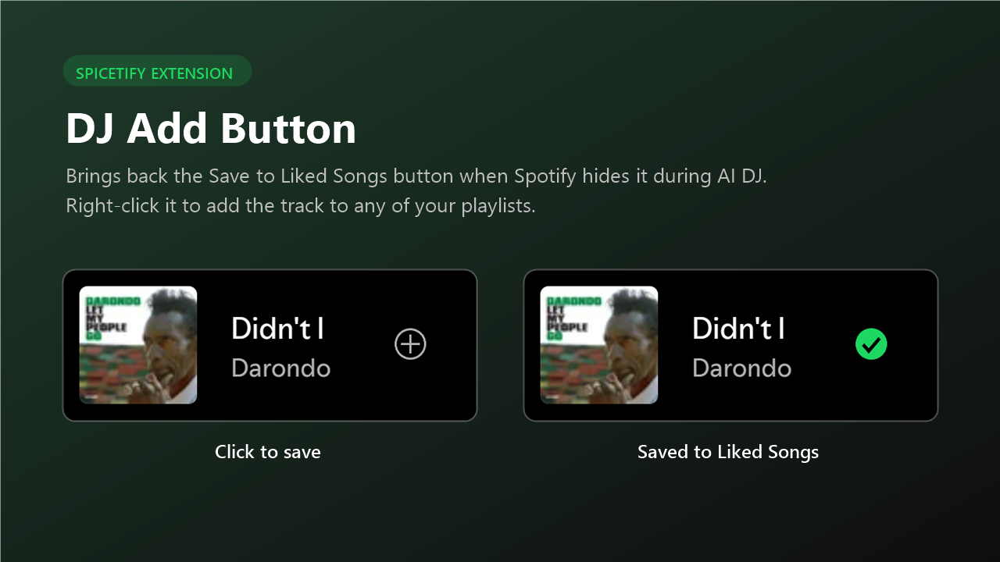

# DJ Add Button

A [Spicetify](https://spicetify.app) extension that brings back the **Save to Liked Songs / Add to Playlist** button in the Spotify desktop playbar when Spotify hides it, as it does during **AI DJ** sessions.




## The problem

When you play Spotify's AI DJ, the `+` / heart button next to the track title disappears from the playbar. To save a song you like, you have to open the queue or the track's context menu, which is awkward while the song is playing.

## Features

- **Appears only when it's needed.** The button shows up next to the track title only when a real music track (`spotify:track:…`) is playing *and* Spotify's own `+` button is missing. During regular playback, it stays hidden.
- **Hides during DJ voice segments, ads and podcasts.** It only appears for tracks you can actually save.
- **Left-click:** save the track to Liked Songs, or remove it. The icon switches between `+` and a green check, and Spotify shows its usual confirmation.
- **Right-click:** open a filterable list of your playlists and add the current track to one of them.
- **Stays in sync:** if you like or unlike the track somewhere else in the app, the button updates.
- **No build step.** `djAddButton.js` is plain JavaScript and runs as-is.

## Installation

### Spicetify Marketplace (recommended)

1. Open **Marketplace** in Spotify (requires [Spicetify Marketplace](https://github.com/spicetify/marketplace)).
2. Go to the **Extensions** tab and search for **DJ Add Button**.
3. Click **Install**.

### Manual

1. Copy `djAddButton.js` into your Spicetify Extensions folder:
   - Windows: `%appdata%\spicetify\Extensions\`
   - macOS / Linux: `~/.config/spicetify/Extensions/`

   (Run `spicetify path userdata` to find the exact location.)
2. Enable it and apply:

   ```sh
   spicetify config extensions djAddButton.js && spicetify apply
   ```

### From a clone of this repo

```sh
./install-local.sh        # macOS / Linux / Git Bash
```

```powershell
.\install-local.ps1       # Windows PowerShell
```

Both scripts copy the extension into `$(spicetify path userdata)/Extensions`, enable it and run `spicetify apply`.

## Uninstall

```sh
spicetify config extensions djAddButton.js- && spicetify apply
```

## Troubleshooting

- **The button never appears during DJ.** Spotify may have changed the playbar markup. Run `spicetify enable-devtools`, open DevTools (Ctrl+Shift+I / Cmd+Opt+I) and check the console for `[djAddButton]` messages. Then open an issue that includes your Spotify and Spicetify versions.
- **Two add buttons show at once.** Spotify's native button is using markup this extension doesn't recognize yet. Please open an issue with the button's HTML from DevTools.

## License

[MIT](LICENSE)
